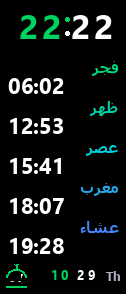

# Mi Band 5 — Prayer Times Watch Face

Show the five daily Islamic prayer times **on a Xiaomi Mi Band 5**, as a watch face — no app, no notifications, just a glance at your wrist.

<p align="center">
  
</p>

The Mi Band 5 is a closed device: it cannot run code, so it cannot *compute* prayer times by itself. This project works around that by **printing the times as an image baked into a watch face**, and **regenerating that watch face automatically every week** so the times stay accurate (they drift ~1 minute per day).

> Designed for **viewing only, not alerting** — a deliberate choice. If you want adhan notifications, this is not that project.

---

## Features

- Five prayer times (Fajr, Dhuhr, Asr, Maghrib, Isha) rendered on-device as an image.
- Times from the **Aladhan API**, default method **13 (Turkish Diyanet)**, for any latitude/longitude you set.
- Live digital clock, date, weekday, battery, and a small animated mosque-dome ↔ crescent logo.
- Arabic or English prayer labels (names are drawn as images, so there is no font/encoding limit on the band).
- **Mid-week anchoring** keeps the weekly face's drift under ~3 minutes instead of ~7.
- Runs on **Windows** (native) or headless **Linux via Docker + Wine** (for an always-on server + cron).
- Delivery through a webhook dispatcher (or a direct Telegram bot token) — you install the file on the band with **Gadgetbridge**.

---

## How it works

`src/main.py` orchestrates four steps:

1. **Fetch times** — `src/times.py` pulls the month's calendar from Aladhan for your coordinates and method, caching a local copy as a network fallback. It picks the *mid-week* day.
2. **Render assets** — `src/render.py` draws, with Pillow, the clock digits, prayer names + times, the animated logo, battery and date — all small images at the real screen size **127×294**.
3. **Pack the face** — `src/pack.py` combines the images and a generated `watchface.json` into a single `.bin` the band understands, using a Windows watch-face packer (`WatchFace.exe`, .NET).
4. **Deliver** — `src/deliver.py` sends the `.bin` to a webhook dispatcher (or directly via a Telegram bot token). You then install it on the band.

---

## Requirements

- **Python 3.10+** with `requests` and **Pillow built with raqm** (for correct Arabic shaping).
- A **Mi Band 5 watch-face packer** (a Windows `.NET` tool such as *MiBandWFTool* / *WatchFace* editors). Place its files in `tools/WatchFace/` — see [`tools/WatchFace/README.md`](tools/WatchFace/README.md). **Not redistributed here.**
- Two TrueType fonts in `fonts/` (the defaults are **Tahoma Bold** + **Segoe UI Bold**, Microsoft fonts you already own on Windows) — see [`fonts/README.md`](fonts/README.md). **Not redistributed here.** You may substitute any readable fonts and update `config.py`.
- For the Linux/Docker path: **Docker**, and the image installs **real .NET Framework 4.8 inside Wine** (see note below).

---

## Setup

```bash
git clone https://github.com/<you>/miband5-prayer-times
cd miband5-prayer-times
python -m venv venv && . venv/Scripts/activate   # or venv/bin/activate on Linux
pip install -r requirements.txt

# 1) add the packer binaries into   tools/WatchFace/
# 2) add two .ttf fonts into         fonts/   (or point config.py at your own)
# 3) set your location/method in     config.py   (CITY, LATITUDE, LONGITUDE, METHOD_ID)
# 4) (optional) copy .env.example -> .env and fill delivery settings
```

### Run

```bash
python src/main.py --no-send   # generate the .bin only, into out/
python src/main.py             # generate AND deliver
```

---

## Deploy on an always-on Linux server (Docker + cron)

The packer is a Windows .NET program, so on Linux it runs under **Wine**. See [`deploy/`](deploy/).

```bash
docker build -t miband-prayer:local .
# one-time: install real .NET 4.8 into a persistent wine prefix volume (see deploy/README.md)
# then schedule deploy/run.sh weekly with cron
```

`deploy/run.sh` runs the container, filters Wine noise, and **alerts via the dispatcher if generation fails** (so a silently broken cron can't let your band drift).

---

## Install on the band

The Mi Band 5 is closed; nothing is pushed to it automatically. Once you have the `.bin`:

1. Get it onto your phone (e.g. via Telegram).
2. Open it with **[Gadgetbridge](https://gadgetbridge.org/)** (open-source companion app).
3. Choose **Install**.

Gadgetbridge needs your band's **Auth Key** and MAC to connect — keep those yourself; they are not part of this project.

---

## Configuration (`config.py`)

Everything lives in one file. The useful knobs:

- `CITY`, `LATITUDE`, `LONGITUDE`, `TIMEZONE` — your location.
- `METHOD_ID` — Aladhan calculation method (default `13` = Diyanet). See the Aladhan docs for other methods.
- `SCHOOL` — `0` standard Asr (Shafi), `1` Hanafi.
- `LANG` — `"ar"` or `"en"` prayer labels.
- `CADENCE_DAYS` / `OFFSET_DAYS` — regeneration period and the mid-week day it anchors on.
- Delivery (`DISPATCH_URL`, `DISPATCH_SECRET`, `TG_CHAT_ID`, `TG_BOT_TOKEN`) are read from environment variables — see `.env.example`.

---

## Why .NET 4.8 and Wine?

The watch-face packer is written in C#, so it needs Microsoft's **.NET Framework** underneath.

- On **Windows** .NET is already installed, so the packer just runs.
- On **Linux** there is no Windows/.NET, so it runs under **Wine**. But Wine ships an open-source .NET replacement, **Wine-Mono**, which *rejects* obfuscated packers with `Invalid IL code`. The fix is to install **real .NET Framework 4.8** into the Wine prefix (`winetricks dotnet48`) and force it over Wine-Mono with `WINEDLLOVERRIDES=mscoree=n`. Store that prefix in a persistent Docker volume so it survives restarts.

---

## Credits

- Prayer times: [Aladhan API](https://aladhan.com/prayer-times-api).
- Install on band: [Gadgetbridge](https://gadgetbridge.org/).
- The Mi Band 5 watch-face packer is third-party (not included).

## License

MIT — see [LICENSE](LICENSE). Applies to this project's own code only, not to the fonts or the third-party packer you supply.
